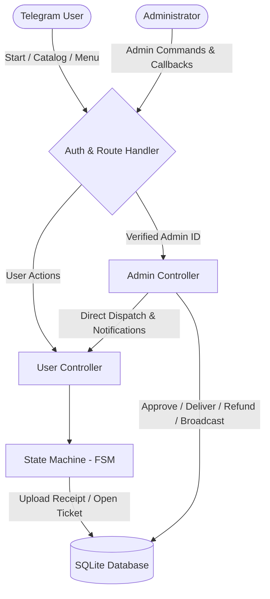

<div align="center">

# 🤖 Telegram Digital Goods Store & Support Bot Framework

[](https://www.python.org/)
[](https://core.telegram.org/bots/api)
[](https://www.sqlite.org/)
[](https://opensource.org/licenses/MIT)
[]()
[]()

<p align="center">
  <b>A lightweight, modular, and asynchronous Python framework for selling digital goods, handling payment receipt verifications, managing live inventory, and providing automated customer support ticketing directly on Telegram.</b>
</p>

</div>

---

## 🚀 Key Highlights & Architectural Features

### 🛍️ 1. Dynamic Catalog & Smart Inventory Management
* **Live Stock Tracking:** Real-time stock counts with immediate availability toggling (`In Stock` / `Out of Stock`).
* **Pre-order / Reservation Pipeline:** When an item is out of stock, users can register free reservations, instantly notifying administrators with user profile links.
* **Rich Media Product Displays:** High-resolution product banners, detailed feature breakdowns, and inline action buttons.

### 💳 2. Payment & Receipt Verification Workflow
* **Bank / Card-to-Card Integration:** Displays payment details with one-touch copyable card numbers and amount formatting.
* **Manual Receipt Review:** Accepts buyer receipt screenshots and forwards them directly to admin private chats with interactive `[Approve]` and `[Reject]` inline controls.
* **Automated Delivery System:** Once approved, admins can dispatch digital credentials/activation URLs with a single tap, triggering automated, formatted instructions to the buyer.
* **Refund Request Protocol:** Built-in fallback allowing admins to request buyer card details for instant refund processing if item provisioning encounters limitations.

### 🎧 3. Two-Way Customer Support & Ticketing System
* **Unique Ticket IDs:** Generates traceable ticket numbers (e.g. `#TCK-1042`) for customer inquiries.
* **Direct Admin Replies:** Admins can reply to tickets with a single click, delivering responses directly to the user's bot chat.
* **Smart Auto-Close (Inactivity Timeout):** Automatically archives and closes resolved tickets after 30 minutes of inactivity to keep the admin queue clutter-free.

### 👑 4. In-Telegram Administrative Dashboard (`/admin`)
* **Role-Based Access Control (RBAC):** Strictly protected via Telegram User IDs (`ADMIN_IDS`).
* **Completed Orders & Customer CRM:** View all past successful transactions with buyer details and instant direct-message buttons.
* **Broadcast Announcements:** Send mass updates or promotions to all registered bot users with delivery statistics.
* **Dynamic Payment Settings:** Update bank card numbers, cardholder names, and bank titles directly from the Telegram chat interface without restarting the server.

---

## 🏛️ System Architecture



---

## 🗂️ Project Directory Structure

```
├── bot.py                  # Application entry point & polling orchestrator
├── config.py               # Robust configuration & environment variable loader
├── database.py             # SQLite data access layer & automated schema migration
├── keyboards.py            # Responsive Reply & Inline keyboard builders
├── handlers_user.py        # Customer workflows (catalog, checkout, tickets, orders)
├── handlers_admin.py       # Administrative workflows (orders, CRM, inventory, settings)
├── Procfile                # Production process specification (PaaS / Cloud ready)
├── runtime.txt             # Python runtime environment declaration
├── requirements.txt        # Minimal production dependencies
├── .env.example            # Environment configuration template
└── README.md               # Documentation & Setup guide
```

---

## 🛠️ Quick Installation & Local Setup

### 1. Clone the Repository
```bash
git clone https://github.com/jaalireza11Biztech/telegram-shop-framework.git
cd telegram-shop-framework
```

### 2. Install Dependencies
```bash
pip install -r requirements.txt
```

### 3. Configure Environment Variables
Copy `.env.example` to `.env`:
```bash
cp .env.example .env
```
Edit `.env` and provide your credentials:
```env
# Telegram Bot API Token (from @BotFather)
BOT_TOKEN=123456789:ABCdefGhIJKlmNoPQRstuVWXyz

# Comma-separated Administrator Telegram User IDs (from @userinfobot)
ADMIN_IDS=123456789

# Default Bank Account Configuration
DEFAULT_CARD_NUMBER=6037-9975-0000-0000
DEFAULT_CARD_HOLDER=Account Holder Name
DEFAULT_BANK_NAME=National Bank
```

### 4. Launch the Bot
```bash
python bot.py
```
*The SQLite database schema and initial catalog items will be automatically initialized on first run.*

---

## ☁️ Deployment Guide

### Cloud & PaaS Platforms (Render, Railway, PythonAnywhere, JustRunMy.App)
This repository is pre-configured with `Procfile` and `runtime.txt`.
1. Upload archive or connect your Git repository.
2. Set `BOT_TOKEN` and `ADMIN_IDS` in the platform's Environment Variables settings.
3. Start the worker process:
   ```bash
   worker: python bot.py
   ```

---

## 🛡️ Security & Privacy
* **Zero Secrets in Repository:** Real tokens, administrator IDs, and private transaction databases are excluded via `.gitignore`.
* **State Machine Isolation:** User sessions and admin states are isolated in memory per chat session.

---

## 📄 License
This project is open-source and available under the [MIT License](LICENSE).
